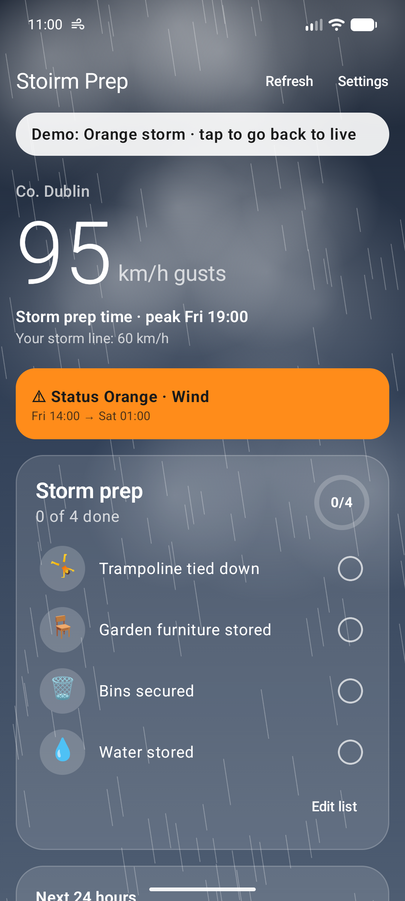
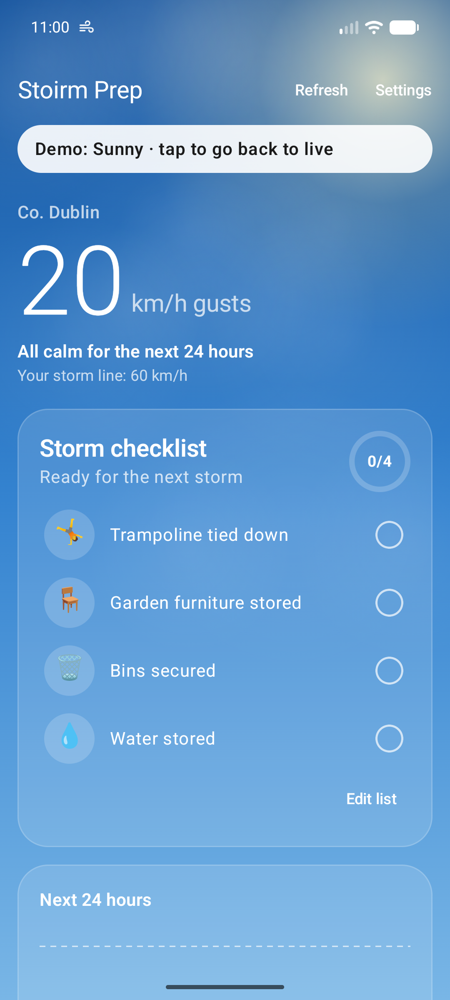

# Stoirm Prep 🌬️

**Storm warnings for exactly your spot, and a family checklist to get ready.**

Stoirm Prep is a small Android app made for a family in Co. Wicklow, Ireland. It watches the Met Éireann forecast for your home, tells you when the wind is going to cross *your* line (say, 60 km/h gusts), shows Met Éireann's official warnings for your county, and keeps a checklist of what needs doing before the storm: trampoline, bins, garden furniture, water stored in case the well pump loses power.

> ⚠️ **Alpha.** It works and it's in daily use, but expect rough edges. It is not a replacement for official warnings: always check [met.ie](https://www.met.ie/warnings).

  
  

## Download

**[📲 Install Stoirm Prep](https://daplein.github.io/apps/stoirm-prep/)** (Android 13 or newer): open that page on your phone and tap *Download for Android*. Or scan this with the phone's camera:

To pass it on, tap **Share** at the top of the app's home screen: someone scans the code, or tap **Send link** to send it in a chat.

All versions and release notes: [Releases](https://github.com/daplein/stoirm-prep-releases/releases)

### Versions

<!-- versions:start -->
| Version | Released (Irish time) | What's new | |
|---|---|---|---|
| [0.5.0-alpha](https://github.com/daplein/stoirm-prep-releases/releases/tag/v0.5.0-alpha) **(latest)** | Mon 26 Oct 2026, 10:46 | Share Stoirm Prep with the family: tap **Share** at the top of the home screen and let them scan the code, or tap **Send link** to send it in a chat. 📲 | [⬇️ APK](https://github.com/daplein/stoirm-prep-releases/releases/download/v0.5.0-alpha/StoirmPrep.apk) |
| [0.4.1-alpha](https://github.com/daplein/stoirm-prep-releases/releases/tag/v0.4.1-alpha) | Fri 23 Oct 2026, 12:26 | The sky now shows the weather outside right now. ☀️💨 | [⬇️ APK](https://github.com/daplein/stoirm-prep-releases/releases/download/v0.4.1-alpha/StoirmPrep.apk) |
| [0.4.0-alpha](https://github.com/daplein/stoirm-prep-releases/releases/tag/v0.4.0-alpha) | Fri 23 Oct 2026, 12:10 | Family sync is here. 👨‍👩‍👧 One checklist for the whole house. | [⬇️ APK](https://github.com/daplein/stoirm-prep-releases/releases/download/v0.4.0-alpha/StoirmPrep.apk) |
| [0.3.1-alpha](https://github.com/daplein/stoirm-prep-releases/releases/tag/v0.3.1-alpha) | Fri 23 Oct 2026, 11:55 | Windy days finally look windy. 💨 | [⬇️ APK](https://github.com/daplein/stoirm-prep-releases/releases/download/v0.3.1-alpha/StoirmPrep.apk) |
| [0.3.0-alpha](https://github.com/daplein/stoirm-prep-releases/releases/tag/v0.3.0-alpha) | Fri 23 Oct 2026, 11:49 | The checklist now knows what kind of day it is. 📋 | [⬇️ APK](https://github.com/daplein/stoirm-prep-releases/releases/download/v0.3.0-alpha/StoirmPrep.apk) |
| [0.2.0-alpha](https://github.com/daplein/stoirm-prep-releases/releases/tag/v0.2.0-alpha) | Fri 23 Oct 2026, 11:10 | The sky now matches every kind of Irish weather. 🌦️ | [⬇️ APK](https://github.com/daplein/stoirm-prep-releases/releases/download/v0.2.0-alpha/StoirmPrep.apk) |
| [0.1.0-alpha](https://github.com/daplein/stoirm-prep-releases/releases/tag/v0.1.0-alpha) | Fri 23 Oct 2026, 11:01 | First alpha of Stoirm Prep. 🌬️ | [⬇️ APK](https://github.com/daplein/stoirm-prep-releases/releases/download/v0.1.0-alpha/StoirmPrep.apk) |
<!-- versions:end -->

## Install (about a minute)

1. Open the [install page](https://daplein.github.io/apps/stoirm-prep/) **on your Android phone** and tap **Download for Android**.
2. When Chrome asks **File might be harmful**, tap **Download anyway** (it asks that for every app that isn't from the Play Store). Keep the page open until it asks.
3. Tap **Open**. When Android asks, allow Chrome to **install unknown apps** (one time only), then tap **Install**.
4. If Google Play Protect warns about an unknown app, tap **More details → Install anyway**. That's expected: the app isn't from the Play Store.
5. Open Stoirm Prep and set your home: type your **Eircode**, or tap **Use my current location** while you're at home.

### Share it with the family (optional)
1. **First phone:** Settings → **Family** → your name → **Create family**. Allow "nearby devices" when asked: that's how phones find each other on your Wi-Fi.
2. **Every other phone:** install, then Settings → **Family** → your name → **Scan to join**, and scan the QR from **Add a phone** on the first phone. Joining takes on the family's list and home.

When a new version is out, a yellow banner on the home screen says so: tap it, download and install over the old one. Your settings and checklist are kept.

## What it does

- **Your own storm line:** an alert when forecast gusts cross your threshold within the next 24 hours (both adjustable).
- **Met Éireann warnings** for your county, in their own Yellow / Orange / Red colours. Switch off types you don't care about.
- **Storm checklist** with before and after items, emoji, progress ring, and items you can put away for the season. "Grand job! All set 🎉" when it's done.
- **Family sync:** one shared checklist, with who ticked what, synced directly between your phones over home Wi-Fi.
- **Reminders** 6 h and 2 h before the peak while items are still open.
- **Quiet hours** (22:00–07:00 by default): only Status Red comes through at night. Can be switched off.
- **The screen matches the weather:** rain from drizzle to downpour, snow, frost, fog, thunder, sun rays or stars, picked from Met Éireann's own forecast. It stops by itself when Battery Saver is on.
- **Try the weather:** preview the app as a red storm, a snow day, a frosty night, fog, a hot sunny day and more.

## Privacy

- No account, no sign-in, no ads, no tracking, no analytics.
- No server: each phone fetches the forecast directly from Met Éireann, and asks [daplein.github.io](https://daplein.github.io/apps/stoirm-prep/latest.json) once per launch whether a newer version is out (nothing is sent).
- Family sync goes **directly between your phones on your home Wi-Fi**, encrypted with a key that exists only in your family's QR code and phones. Nothing goes through the internet.
- Your home location is stored **only on your phone**. Location is read once, when you tap the button, never in the background.
- Permissions: internet (forecast, new-version check), location (only when you ask), notifications (alerts), nearby devices / local network (only for family sync).

## Data: thank you, Met Éireann 🙏

Every forecast and warning comes from **[Met Éireann](https://www.met.ie)**, the Irish national meteorological service, through their [open data](https://www.met.ie/about-us/specialised-services/open-data) (CC BY 4.0). This app exists thanks to them. Stoirm Prep is not affiliated with or endorsed by Met Éireann.

## Feedback

Found a bug or have an idea? [Open an issue](https://github.com/daplein/stoirm-prep-releases/issues).

The app's source code is private for now; this repository only hosts releases.
